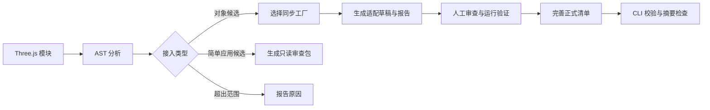
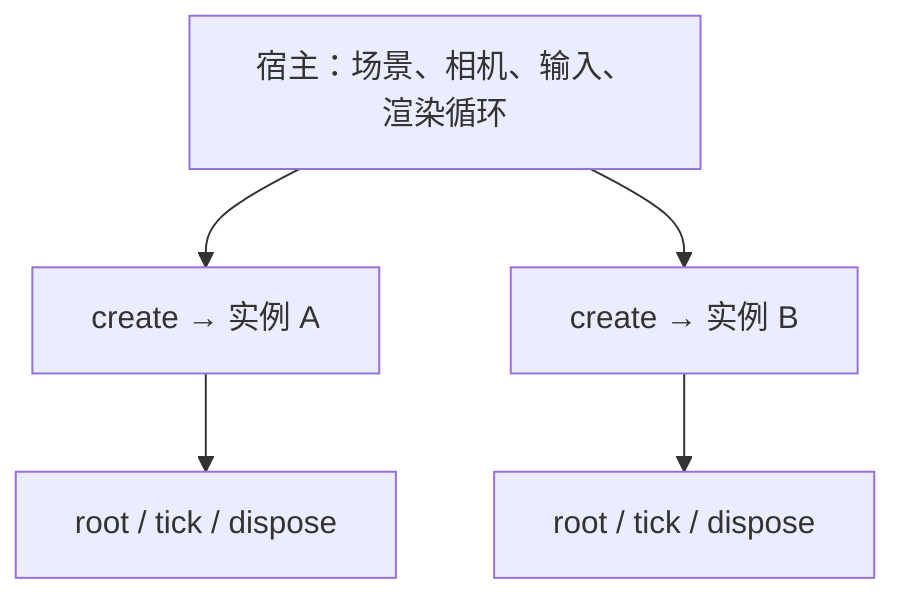

<div align="center">

# Orbity Core

### 自由地，分发。组合。共创。

**为 Three.js 代码资产建立共同语言。**

协议草案 · 源码分析 · 规则适配 · 资产审查 · 实例生命周期

[体验 Orbity](https://orbity-3d.top/) · [在线文档](https://orbity-3d.top/#/docs) · [Adapter Lab](https://orbity-3d.top/#/adapter) · [网站仓库](https://github.com/EndlIa/Orbity-site)

</div>

---

## 为什么需要 Orbity？

越来越多的三维对象直接以 Three.js 代码表达：几何体、材质、部件关系，以及对象自身的动画，都可以保存在一个模块里。

但“能在原来的页面运行”与“能被其他人复用”之间仍有距离。模型可能与相机、渲染循环、DOM 和展示环境耦合；工厂入口没有共同约定；资源由谁释放、多个实例能否共存，也常常需要重新确认。

Orbity 探索一套共同的描述与接入规范，让这些散落的代码更容易被整理、审查、分发和组合，并为围绕代码资产的社区协作提供基础。

**Orbity Core 是这套体系的技术核心。**

## 目录

- [项目组成](#项目组成)
- [能力与实现状态](#能力与实现状态)
- [快速开始](#快速开始)
- [从源码到适配草稿](#从源码到适配草稿)
- [运行时契约](#运行时契约)
- [清单、组合与内容标识](#清单组合与内容标识)
- [CLI](#cli)
- [JavaScript API](#javascript-api)
- [架构与目录](#架构与目录)
- [信任边界](#信任边界)

## 项目组成

| 项目 | 职责 | 入口 |
| --- | --- | --- |
| **Orbity Core** | 协议草案、源码分析、规则适配、审查与检查工具 | 当前仓库 |
| **Orbity Site** | Demo 前端 | [Orbity-site](https://github.com/EndlIa/Orbity-site) |

## 能力与实现状态

| 能力 | 当前实现 | 边界 |
| --- | --- | --- |
| 模块分析 | 使用 AST 解析模块、导出、依赖和部分运行时线索 | 不执行输入源码，不证明返回值是模型 |
| 工厂识别 | 支持同步函数导出、函数变量、默认导出及可解析的本地别名 | 排除异步、生成器、类及无法可靠解析的绑定等情况 |
| 对象适配 | 为选定工厂生成入口、实例运行时、清单草稿与报告 | 单文件入口的机械封装，不自动迁移任意应用 |
| 简单应用审查 | 识别候选并生成只读审查包与迁移清单 | 不生成可执行的 Orbity 应用入口 |
| 清单校验 | JSON Schema 与部分跨字段规则 | 通过校验不等于完整协议认证 |
| Bundle 检查 | 检查清单、入口文件及格式，计算字节级内容摘要 | 不运行资产，不验证完整渲染行为 |
| 实例桥接 | 为已知对象工厂提供实例时间与常见资源释放 | 复杂或共享资源所有权仍需人工设计 |
| 生命周期探针 | 创建两个实例，观察部分隔离与释放行为 | 属于有限检查，不覆盖所有副作用 |
| 纹理宿主 | 受限绘制接口、尺寸及操作预算、实例资源作用域 | 是能力接口，不是执行沙箱 |
| 辅助工具 | 符号提取、源码差异、兼容性观察、报告与草稿 ZIP | 用于审查，不替代运行验证 |

### 当前范围

- **对象资产**：可由同步工厂构造的 Three.js 对象，允许对象自身带动画。
- **简单应用**：保留源文件与审查信息，作为后续人工迁移的材料。
- **规则优先**：转换规则和待确认项可查看，不以自动补全掩盖未知信息。

参数、边界、真实单位、动画能力认证、连接点及碰撞体等扩展暂缓进入当前产品流程。正式协议草案保留了相关要求，具体区别见 [MVP profile](spec/mvp-profile.md)。

## 快速开始

### 获取与验证

建议使用 **Node.js 24**。当前依赖与示例以 **Three.js 0.169.0** 为基准，其他版本需要自行验证兼容性。

```bash
git clone https://github.com/EndlIa/Orbity-DEMO.git
cd Orbity-DEMO
npm ci
npm test
```

检查打包文件清单：

```bash
npm run pack:check
```

在另一个本地项目中，可以通过目录安装 Core：

```bash
npm install ../Orbity-DEMO
```

也可以在浏览器中体验 [Adapter Lab](https://orbity-3d.top/#/adapter)

## 从源码到适配草稿



### 1. 检查模块

以下代码可以在仓库根目录保存为 `inspect-example.mjs`，然后通过 `node inspect-example.mjs` 运行：

```js
import { inspectModule, generateAdapter } from './src/index.js';

const source = `
import * as THREE from 'three';

export function createModel() {
  return new THREE.Mesh(
    new THREE.BoxGeometry(1, 1, 1),
    new THREE.MeshStandardMaterial({ color: 0xdfff00 }),
  );
}
`;

const inspection = inspectModule(source);
console.log(inspection.factories); // ['createModel']
console.log(inspection.findings);

const draft = generateAdapter({
  source,
  factory: 'createModel',
  filename: 'model.ts',
});

console.log(Object.keys(draft.files));
console.log(draft.files['entry.js']);
```

输入示例中的 Three.js 代码是作为字符串被分析的；上述步骤不会执行它。

### 2. 审查生成结果

适配草稿包含原始源码、生成入口、实例运行时、`orbity.draft.json` 和适配报告等文件。原始源码保持原样；生成器不会凭空推断真实单位、边界、许可或可编辑参数。

需要重点确认：

1. 选中的导出是否确实返回 `THREE.Object3D`。
2. 是否存在相机、渲染器、DOM、网络或独立循环等宿主耦合。
3. 依赖是否已解决，TypeScript 是否有对应构建支持。
4. 对象是否能独立实例化，资源是否有明确所有者。
5. 清单中的来源与许可信息是否已核实。

### 3. 验证后再完善正式清单

`orbity.draft.json` 是审查材料。应在解决依赖、验证行为并完善所需字段后，再保存为正式的 `orbity.json`，进入 CLI 检查。

完整工作流见 [适配说明](docs/ADAPTER.md)。该文档也涉及 Site 中的 Adapter Lab；Core 本身不提供网页。

## 运行时契约

当前 MVP 的对象入口形状为：

```ts
create(host?) -> {
  root: THREE.Object3D;
  tick?: (dt: number) => void;
  dispose: () => void;
}
```

每次 `create()` 返回一个独立实例。宿主驱动 `tick(dt)`，时间以秒计，必须为有限非负数；实例维护自己的时间和可变状态。



- **宿主负责**相机、输入、环境、渲染循环和对象放置。
- **资产负责**自己的对象树、内部状态及其拥有的资源。
- `dispose()` 应可重复调用，移除根对象并释放实例拥有的资源。
- 释放一个实例不应破坏另一个实例；共享资源需要明确的所有权策略。

这些是协议要求。桥接器和探针只实现其中一部分检查，不会自动证明任意资产满足全部要求。

### 已知工厂的桥接

```js
import * as THREE from 'three';
import { createModelInstance, probeInstances } from './src/index.js';

const factory = () => new THREE.Mesh(
  new THREE.BoxGeometry(),
  new THREE.MeshStandardMaterial(),
);

const instance = createModelInstance(factory);
instance.tick(1 / 60);
instance.dispose();

const report = probeInstances(() => createModelInstance(factory));
console.log(report.status);
```

`createModelInstance` 可以桥接 `root.userData.tick(dt, elapsed)`，并遍历释放常见几何体、材质和贴图。它不是任意资源管理系统；例如跨实例共享的资源需要额外处理。

### 受限纹理绘制

资产可通过 `host.createTexture({ width, height }, draw)` 请求纹理。绘制回调只能访问受限接口，返回的 Three.js 纹理持有像素数据，不向资产暴露原生 Canvas 或上下文。

默认参考实现限制单边尺寸为 2048、并存像素为 4,194,304、单次文本长度为 4096，以及每张纹理 20,000 次绘制操作。每次实例创建应使用独立纹理作用域。

接口定义见 [runtime.d.ts](spec/runtime.d.ts)，实现见 [texture-host.js](src/texture-host.js)。

## 清单、组合与内容标识

| 概念 | 作用 | 当前状态 |
| --- | --- | --- |
| Bundle | 代码资产及其入口、元数据、能力声明 | 草案与部分工具实现 |
| Manifest | 用 `orbity.json` 描述 Bundle | Schema 与部分语义校验已实现 |
| Composition | 记录多个资产的实例及组合关系 | 协议与 Schema 草案 |
| Integrity | 按文件内容计算的确定性标识 | 本地 Bundle 摘要检查已实现 |
| Registry | 按内容标识存储、解析资产 | 尚未实现 |

正式草案将 Bundle 定义为组件：不应创建自己的相机、渲染器、DOM 容器或独立渲染循环。Composition 的内容锁定、真实单位以及完整一致性要求，不应与 Site 当前的本地场景 JSON 混为一谈。

### 两种文件，不同承诺

| 文件 | 含义 |
| --- | --- |
| `orbity.draft.json` | Adapter 生成的待审查材料，可以包含尚未解决的信息 |
| `orbity.json` | 待检查的正式清单，须满足当前 Schema、值约束与格式要求 |

即使 `orbity.json` 通过 CLI，运行时一致性仍需另行验证。

### 字节级摘要

工具按 UTF-8 路径字节序排列文件，对各文件原始字节计算 SHA-256，再对路径与文件摘要组成的载荷计算 Bundle 摘要。它不会规范化源码换行或重编码。

`orbity.json` 使用递归排序的键、UTF-8 无 BOM、两空格缩进、LF，以及末尾单个换行。当前工具拒绝符号链接；固定排除项与精确算法见 [协议的 Integrity 部分](spec/README.md#4-integrity)。

## CLI

CLI 当前仅提供两个子命令：

```bash
# 校验正式清单的 Schema 与部分值约束
npm run orbity -- validate ./path/to/orbity.json

# 检查 Bundle 目录并输出 JSON 报告
npm run orbity -- inspect ./path/to/bundle
```

`inspect` 的输出包含资产 ID、版本、内容摘要、文件清单与检查状态。它要求目录包含正式 `orbity.json`，清单入口指向包内文件，且清单格式符合约定。

**通过的含义是清单与文件检查通过。** 输出中的运行时仍为 `not run`，一致性仍为 `not certified`。失败时命令返回非零退出状态，适合接入自动化文件检查流程。

## JavaScript API

通过包根入口使用时，从 `@orbity/core` 导入。以下是公共导出的职责索引；参数结构以实现和测试为准。

| API | 职责 |
| --- | --- |
| `inspectModule` | AST 模块检查、工厂候选与排除原因 |
| `generateAdapter` | 生成对象候选的适配草稿 |
| `generateSimpleAppReview` | 生成简单应用的只读审查包 |
| `analyzeSource` | 轻量文本提示；不同于 AST 检查，不用作解析器或安全扫描器 |
| `extractSymbols` / `findLines` | 符号与源码定位辅助 |
| `assessAsset` / `buildAdaptationReport` | 兼容性观察与适配报告 |
| `createModelInstance` / `probeInstances` | 已知工厂桥接与双实例检查 |
| `createTextureHost` | 受限纹理绘制宿主 |
| `validateManifestDraft` / `canonicalManifest` | 正式 Schema 审查及清单格式化 |
| `validateManifest` / `defaults` / `validateValues` | 原型内部清单及参数工具；不等同正式协议认证 |
| `diffSource` / `unifiedPatch` | 源码差异与补丁 |
| `createDraftZip` | 打包审查草稿 |

公共入口见 [src/index.js](src/index.js)。正式 Bundle CLI 使用的校验路径见 [tools/bundle-tools.js](tools/bundle-tools.js)。

## 架构与目录

```text
Orbity-DEMO/
├── spec/                     # 协议与类型定义
│   ├── README.md             # orbity/0.1 正式草案
│   ├── mvp-profile.md        # 当前原型工作约定
│   ├── manifest.schema.json  # Bundle 清单
│   ├── composition.schema.json
│   ├── runtime.d.ts          # 实例与纹理宿主接口
│   └── conformance.md        # 一致性检查设计
├── src/                      # 分析、适配、审查及宿主辅助
├── tools/                    # CLI 与 Bundle 文件检查
├── tests/                    # Node 测试
├── docs/                     # 设计与接入说明
└── package.json
```

## 信任边界

分析阶段不执行输入源码。生成的入口一旦被导入，原始模块就可能执行初始化代码；静态识别、适配包装和纹理接口都不构成沙箱。

在运行候选资产前，应审查依赖、模块初始化、副作用和资源所有权。面向不受信任代码的公开执行，需要独立隔离与资源限制；当前仓库没有提供完整方案。

工具不自动验证版权或许可证，不推断真实物理单位，也不会把静态发现的函数直接认证为可复用模型。
